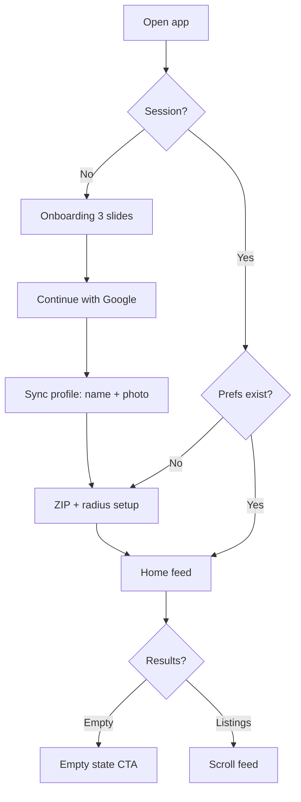
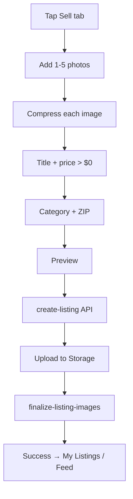
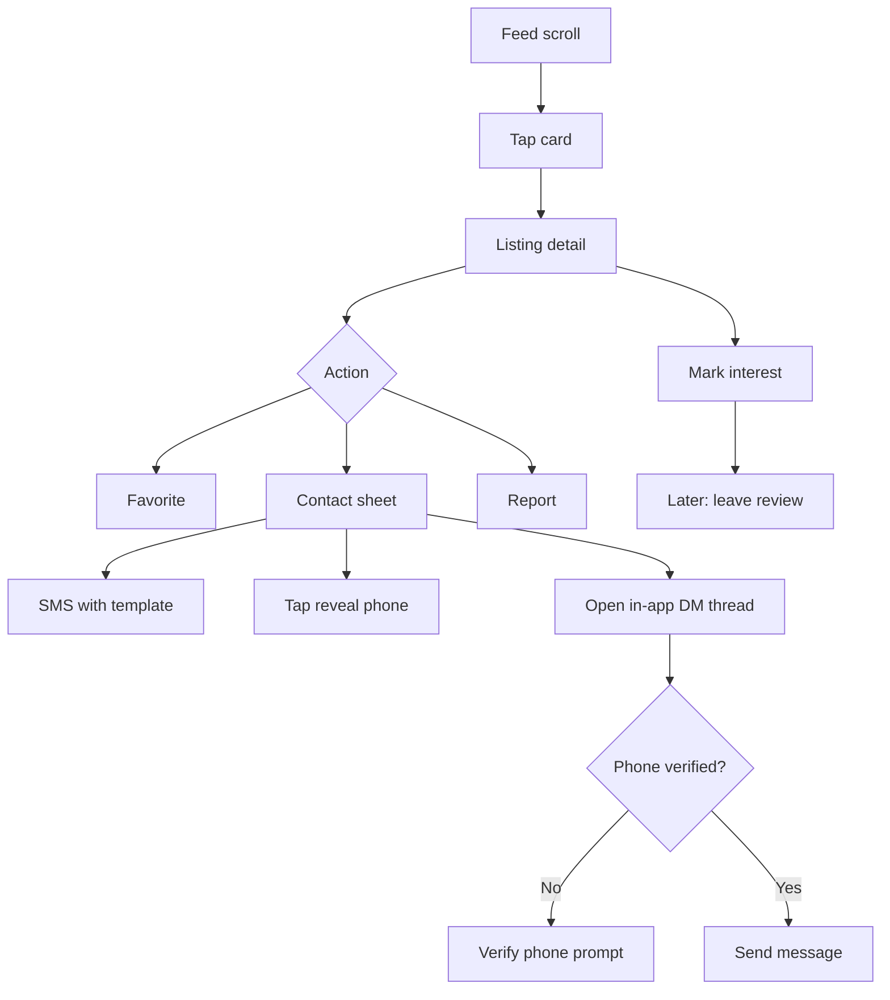
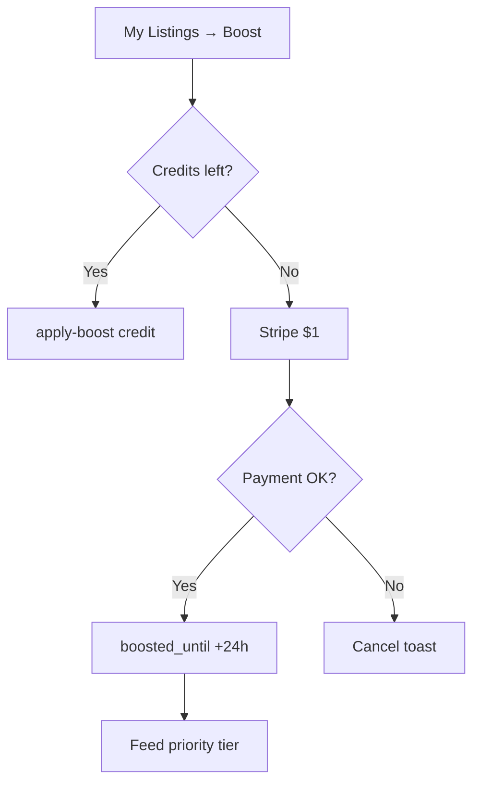
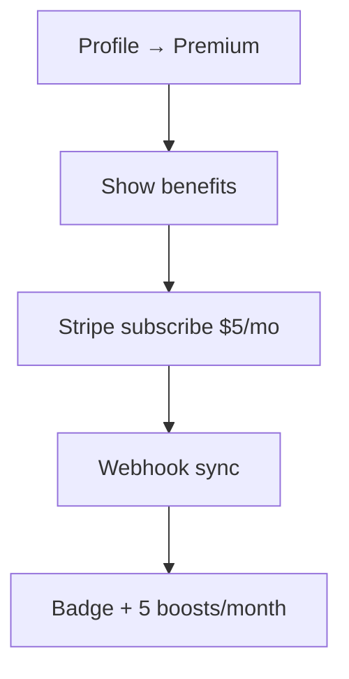

# Local Marketplace — User Flows (Detailed)

**Version:** 1.2  
**Companion:** [01-PRD.md](./01-PRD.md) §7

---

## 1. Flow index

| ID | Flow | Primary actor |
|----|------|---------------|
| F1 | First launch → feed | New user |
| F2 | Post listing | Seller |
| F3 | Browse → contact | Buyer |
| F4 | Boost listing | Seller |
| F5 | Premium subscribe | Seller |
| F6 | Report / block | Any user |
| F7 | Review seller | Buyer |
| F8 | Listing expiry | System |

---

## 2. F1 — First launch

**Exit criteria:** Feed loads with geo filter or empty state with widen/post CTAs.

---

## 3. F2 — Post listing

**Failure paths:**

- Price ≤ 0 → inline error
- Banned keyword → toast + block submit
- Upload fail → retry single image

---

## 4. F3 — Browse → contact

**In-app DM**: opening a thread creates (or reuses) one `conversations` row per listing/buyer pair. Sending a message requires phone verification, is capped at 15 messages/minute per conversation, and runs through the banned-keyword filter. Sellers can mark the listing sold (ends the thread) or delete the conversation from the thread view; blocking the other user blocks further sends both ways.

---

## 5. F4 — Boost listing

---

## 6. F5 — Premium subscribe

---

## 7. F6 — Report / block

| Step | Screen |
|------|--------|
| 1 | Detail ⋮ menu |
| 2 | Select reason |
| 3 | Optional details → submit |
| 4 | Thank you; optional hide listing |

**Block:** Profile or detail → Block → confirm → feed excludes seller.

---

## 8. F7 — Review seller

**Precondition:** `listing_interest` exists for buyer+listing.

1. Prompt on detail after contact OR push notification (future)
2. 1–5 stars + optional text
3. Update seller `rating_avg`

---

## 9. F8 — Listing expiry (system)

| Day | User-visible | Backend |
|-----|--------------|---------|
| 12 | Push warning | cron notification |
| 14 | Hidden from feed | status = expired |
| 21 | Gone | purge job + storage delete |

Seller can **mark sold** earlier → stops expiry notifications.

---

## 10. Screen → flow map

| Screen | Flows |
|--------|-------|
| Onboarding | F1 |
| Sign-in | F1 |
| Feed | F1, F3 |
| Sell wizard | F2 |
| Listing detail | F3, F6, F7 |
| My listings | F2, F4 |
| Premium | F5 |
| Settings/safety | F6 reference |
| Favorites | F3 |

---

## 11. Error & cancel flows (required UI)

| Scenario | UX |
|----------|-----|
| Google OAuth canceled | Return to sign-in, no error toast |
| Geocode invalid ZIP | Inline error, block continue |
| Feed fetch failed | Retry button + offline banner |
| Listing create keyword hit | Toast with reason, stay on form |
| Boost payment failed | Toast, listing unchanged |
| Report submitted | Thank you + optional hide listing |
| Empty feed | Widen radius + post CTA |

---

## 12. Edge cases

| Case | Behavior |
|------|----------|
| Seller edits price to any positive amount | Allowed |
| Seller edits to $0 or negative | Rejected |
| Boosted listing expires | Boost does not extend expiry |
| User changes ZIP | Feed refetch, new radius |
| Blocked seller | Listings invisible |
