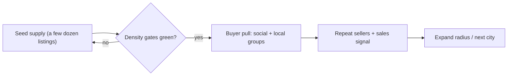

# Local Marketplace — Launch & Growth Plan (template)

**Version:** 1.0
**Owner:** Founder/operator

This is a **reusable playbook**, not a record of a specific launch. Fill in your own first market, dates, and numbers before you use it. It assumes a **campus- or neighborhood-first** launch, but the phases apply to any single-city rollout.

> Read alongside [20-Seed_Content_Strategy.md](./20-Seed_Content_Strategy.md) (supply playbook), [19-Analytics_and_Growth.md](./19-Analytics_and_Growth.md) (events/metrics), [24-Brand_and_Marketing_Copy.md](./24-Brand_and_Marketing_Copy.md) (copy templates).

---

## 0. Positioning

- **What it is:** cheap, hyperlocal pickup deals, near you — no fixed price cap.
- **Brand hook:** a low-price sort/filter to surface the cheapest finds.
- **Audience:** pick a first market (e.g. a college campus, a neighborhood, a small city) — **open to all locals**, no signup gating. The optional `.edu` student badge is useful if your first market is a campus.
- **Money flow:** in-person, cash/Venmo/Zelle. We are **not** a payment processor (see legal). Revenue = **boosts**, **Premium seller** subscriptions, and **AdMob ads** — never a cut of item sales. Set your own prices for boosts/Premium; the examples below use $1 boosts and $5/mo Premium as a starting point.

---

## 1. Why supply-first (the cold-start trap)

Marketplaces die from **empty feeds**, not from lack of buyers. A buyer who opens a dead feed once rarely returns. Therefore: **do not spend a dollar or an hour on buyer acquisition until the supply gates below are green.** Until then, 100% of effort goes to listings + creators + sellers.

---

## 2. Success metrics & gates

Pick your own numeric targets based on market size; the rows below are a reasonable starting point for a single ZIP/campus launch.

| Metric | Definition | Example gate to advance |
|--------|------------|-----------------|
| **Live listings** in your launch ZIP cluster | active, not expired | ≥ **50** before any buyer push |
| **Active sellers** | posted ≥1 live listing | ≥ **20** before any buyer push |
| **Sale/meetup signal** | qualitative ("sold it!") OR interest event + marked sold | ≥1 per 5 active sellers |
| **Listings/day** | new live listings per day | ≥ **5/day** by day 14, ≥ **10/day** to expand |
| **Empty-feed rate** | sessions that render <6 cards in radius | < **30%** |
| **Contact rate** | phone-reveal or DM per listing view | trending up week-over-week |

Track via your analytics provider + the weekly SQL in [19-Analytics_and_Growth.md](./19-Analytics_and_Growth.md). **No paid ads until the first three rows are green.**

---

## 3. Calendar anchor

If your first market has a natural seasonal cycle (school year, moving season, holidays), time the public push to a high-demand window and seed supply 2–4 weeks ahead of it. For a college-town launch, that typically looks like:

| Moment | Why it matters | Action |
|-----------|----------------|--------|
| **Move-in / term start** | Peak buyer demand (dorm/apartment setup) — best launch window | Seed a few weeks ahead; public push during welcome week |
| **Finals → break** | Move-out + cash-cleanout selling | Seller recruitment push |
| **Term restart** | Second buyer wave | Re-engage dormant sellers |
| **End of year move-out** | Large supply dump (furniture, dorm goods) | Founding-seller + seed payouts |

> Confirm exact dates for your market each cycle before committing spend.

---

## 4. Phase timeline (day-by-day template)

### Phase A — Pre-seed (~2–3 weeks before launch)
- Lock a launch date to a high-demand window (§3) for your market.
- Recruit **10–20 founding sellers** (friends, local groups/communities). Consider comping them Premium so listings get the longer expiry window.
- Personally photograph + list your own clutter to hit a baseline.
- Set up social accounts; film several videos in the bank (don't post yet).
- Confirm legal/site are live and the waitlist form (if used) is wired.

### Phase B — Seed sprint (~1–2 weeks before launch)
- Run a small seed program (e.g. a flat per-listing incentive) with admin approval. Target a few dozen live listings across every category, varied cheap prices.
- Use the **extend-expiry** admin action as a safety net so nothing seeded expires before launch day.
- Beta test with a small internal group; goal is extra listings from real users.
- Post a couple of warm-up social videos; start the waitlist if you're using one.

### Phase C — Launch week (Day 0–7)
- **Day 0:** launch on whichever platform(s) are ready first. Post launch-day content. One honest post in a couple of relevant local buy/sell groups — looking for **sellers** first.
- **Day 1–7:** one piece of "find of the day" content per day. Action every report promptly. Reach out to a few power sellers (thank + boost), nudge a few dormant sellers to relist.
- Watch empty-feed rate; if a category is thin, seed it directly.

### Phase D — Density & loop (Day 8–30)
- Keep posting daily → taper to a few times a week.
- Turn on **buyer pull** only once §2 gates are green: more social distribution, local flyers/QR, community shoutouts.
- Introduce a lightweight "founding seller leaderboard" (free Premium / badge reward).
- Begin light **monetization**: enable boosts, pitch Premium to top sellers.

### Phase E — Expansion gate (Day 30+)
- Expand radius or add another city **only after a sustained run** (e.g. 14 consecutive days) of: rising new-listings/day, repeat sellers, empty-feed rate under your target, and contact rate trending up.

---

## 5. Creator marketing playbook (focused, low-budget)

Budget is typically small, so spend it on **micro/nano creators** and your own content engine rather than broad ad buys.

- **Who:** local micro (10k–50k) / nano (1k–10k) creators in niches relevant to your market (e.g. thrift/dorm/budget-living). Local relevance beats follower count.
- **Offer:** small flat fee or free Premium + a unique promo code; one authentic "I found X for $Y near me" video. Disclose sponsorship per FTC guidance.
- **Volume play:** several nano creators posting once each usually beats one mid-size creator for local seeding.
- **Owned content (free, highest ROI):** a daily "find of the day" series, a "cheap finds nearby" hook, a "weirdest thing near me" treasure-hunt format. Reuse across short-form video platforms. See templates in [24-Brand_and_Marketing_Copy.md](./24-Brand_and_Marketing_Copy.md).
- **Measure:** unique promo codes + UTM on the waitlist/app link; compare installs and first-listing rate per creator before reinvesting.

| Budget tier | Allocation |
|-------------|------------|
| ~$0 | Owned social series + local groups + flyers/QR |
| Small | A handful of nano creators (flat fee / Premium comp) + a small print run |
| Larger | Add 1–2 micro creators; only after §2 gates are green |

---

## 6. Community (the moat)

- **Founding Sellers** get a badge + comped Premium; spotlight them.
- Respond to every report/DM fast; visible moderation builds trust at low prices.
- Lightweight rituals: featured creator spotlights, seller leaderboard, purchase-verified review highlights.
- Avoid stretching the product thin — **no dedicated social feed in MVP**; community lives in the listings + creator content, not a new surface.

---

## 7. Risks & failure signals

| Signal | Likely cause | Action |
|--------|--------------|--------|
| Empty feed > 50% sessions | too little supply / radius too tight | seed more, widen radius messaging |
| Installs but no listings | seller incentive weak | push founding/seed program, concierge posting |
| Listings but no contacts | weak photos/titles, trust | coach sellers, surface safety copy |
| Reports > 2% listings/week | bad actors | tighten moderation, ban farm accounts |
| Seed payout abuse | farming | enforce per-person caps + admin approval on any seed program |

---

## 8. Weekly operator routine (~30–45 min)

1. Pull listings/day + supply/demand ratio (SQL in doc 19).
2. Clear the report queue promptly.
3. Post/schedule social content; check creator code performance.
4. Message a few dormant sellers (relist/extend); thank your top sellers.
5. Update gate metrics; decide expand / hold / fix.
